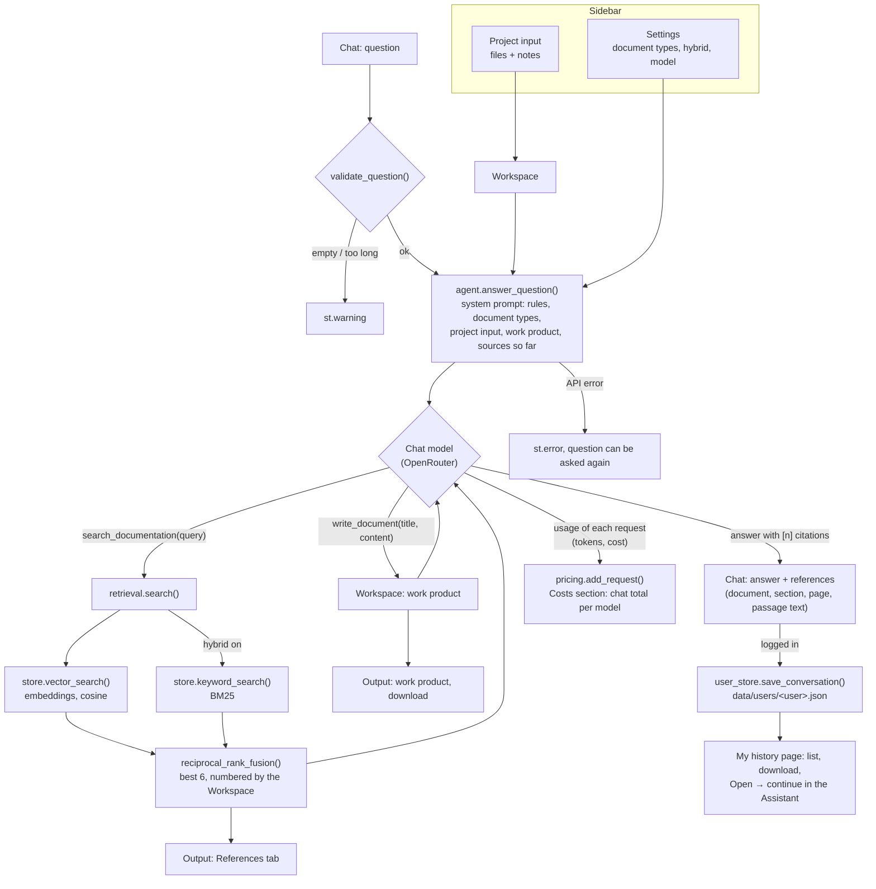

# Architecture

Building Rules Assistant: a chatbot that helps find the building regulations and standards that apply to a project, from documents in a knowledge base (task description: `125.md`).

## Components

All modules are in `src/scanya_ae_afa_updated0209_2_5/`.

| Component | Location | Purpose |
|---|---|---|
| App entry | `app.py` | Page setup, the only custom CSS, navigation between the three pages, and the login box at the top of the sidebar. Run with `start_app.bat`. |
| Assistant page | `page_chat.py` | The main page, five sections: **Project input**, **Settings** and **Costs** (sidebar), **Chat** (left), **Output** (right: work product, references and search steps). Only draws and stores the session state; no feature logic. |
| Knowledge base page | `page_library.py` | Secondary page: upload documents into a category, list and remove them, rebuild the index. |
| History page | `page_history.py` | "My history": the saved conversations of the logged-in user, each with its cost, a download of its work product and an *Open* button. |
| Chat agent | `agent.py` | `answer_question()`: a LangChain agent (`create_agent`) with two tools, `search_documentation` and `write_document`. Yields its steps as `Event`s. No Streamlit code. |
| Workspace | `workspace.py` | `Workspace`: what one conversation works with besides the messages: project input (the user's files and notes), the work product, and the numbered sources. No Streamlit code. |
| Prompts | `prompts.py` | The system prompt and the fixed tool answers, as constants. |
| Search | `retrieval.py` | `search()`: vector search + keyword search merged with Reciprocal Rank Fusion; keyword part can be switched off. |
| Search index | `store.py` → `data/index/` | One LanceDB table with text, embedding and metadata of every chunk. The only module that talks to the database. |
| Document library | `library.py` → `data/library/<category id>/` | `add_document()`, `remove_document()`, `list_documents()`, `sync_index()` (embed new files, drop deleted ones), `rebuild_index()` (embed everything again). Keeps the original files, so the index can be rebuilt. |
| Build tool | `build_index.py`, `build_index.bat` | The same sync and rebuild from the command line, without the app. Shows what it will do and the estimated cost, and asks before embedding. |
| Chunking | `chunking.py` | `read_pages()` (PDF with `pypdf`, TXT, MD) and `split_pages()`: overlapping chunks that keep their page number and their section (the headings above them, e.g. "4 Bäder › 4.2 Lüftung"). |
| Embeddings | `embeddings.py` | `OpenRouterEmbeddings`: LangChain-compatible wrapper around `config.get_client()`. |
| Auth | `auth.py` | Optional login with `streamlit-authenticator`: `login_area()` draws log in / create account (or "signed in as" + logout), `current_user()` tells the pages who is logged in. Taken from the Sprint 1 project. |
| Accounts | `config.yaml` | User accounts (bcrypt-hashed passwords) and the login-cookie key. Committed on purpose: one dummy account for now. |
| User store | `user_store.py` → `data/users/` | Per-user history: one JSON file per user with all conversations (messages, workspace, settings, usage). No Streamlit code. |
| Pricing | `pricing.py` | Cost of every chat-model request, added up per model: the cost OpenRouter reports, else tokens × the model's price from the OpenRouter models endpoint. `estimate_answer_cost()` gives the cost of one typical answer per model, shown under the Model select box. `format_usd()` for display. Taken from the Sprint 1 project. |
| Categories | `categories.py`, `categories.toml` | The document types (id, name, description). Edit the TOML file to change them. |
| Config | `config.py` | Taken from the Sprint 1 project: `get_client()` (OpenAI SDK client for OpenRouter, key from `.env` / the environment), plus `get_chat_model()` for LangChain. |
| Settings | `settings.py` | Constants: folders, model names, chunk and search parameters, limits. |
| Streamlit config | `.streamlit/config.toml` | Accent colour and upload size limit. |
| Tests | `tests/test_backbone.py`, `tests/test_history_and_costs.py`, `tests/test_build_index.py` | Offline tests with fake models and a fixed price list (`uv run pytest`). |
| Task tracker | `TASKS.md` | Status of the core and optional tasks from `125.md`. |
| README | `README.md` | Features, setup, how to run. |

## How they work together

**Knowledge base** (prepared once, extended any time). On the Knowledge base page the user picks a category and uploads files. `library.add_document()` reads the text (`chunking.read_pages()`) and splits it (`split_pages()`): first at every recognised heading, then into chunks of about 1,000 characters, never across a page. Each chunk is embedded (`embeddings.py`) and stored as one row in LanceDB (`store.add_chunks()`): text, vector, category, file name, section, page. What is embedded and keyword-indexed is the passage together with its file name and section headings. The original file is kept in `data/library/<category id>/`.

**A conversation** happens on the Assistant page. The user can describe the project in the *Project input* section (files and notes, kept in the `Workspace`, not added to the knowledge base), choose in *Settings* which document types are searched, whether hybrid search is on and how many passages the model gets per search, and then chats. For each question `page_chat.py` calls `agent.answer_question()` with the question, the earlier messages, the workspace and the settings.

**One answer.** The agent's system prompt contains the rules of behaviour, the active and switched-off document types, the project input, the current work product and the list of passages found so far. The chat model then decides which tools to call:

- `search_documentation(query)` → `retrieval.search()` runs `store.vector_search()` and (if hybrid is on) `store.keyword_search()`, both restricted to the active categories, and merges the two rankings. Each passage gets a number from the workspace (`Workspace.add_source()`); the same passage keeps its number for the whole conversation. The model receives the numbered passages (as many as set in *Settings*, 6 by default) with document, section and page.
- `write_document(title, content)` → replaces the work product in the workspace.

After reading the passages the model may search again, with other words or for an article the passages refer to, as often as it finds necessary (at most `MAX_AGENT_STEPS` steps, about 7 searches). It then answers, citing passage numbers like `[1]`. The page shows every step while it happens (status box), the answer, and below it the cited references: document, section, page, and the exact passage text. The *Output* section shows the work product (with its own references and a download button) a *References* tab listing every passage found in the conversation, and a *Search steps* tab: for each answer the path the agent took (Question → Search 1 → Search 2 → Answer), the settings it was made with, and for every search all passages the model was given, best first, with two match values as bars and a mark on the ones the answer cites.

**Costs.** Each answer needs several requests to the chat model (one per tool round, plus the final one). `answer_question()` reports each of them as a `usage` event with the model and the token counts LangChain returns. The page adds them to the conversation's usage (`pricing.add_request()`), also when the run fails afterwards, since those requests are billed too. The *Costs* section shows the total of the chat, one line per model used, and for a logged-in user the total over all saved conversations (`user_store.total_cost()`).

**Logged-in users** (optional, `auth.py`). The app works without an account. `app.py` draws the login box in the sidebar on every page; a login is remembered by a cookie for 30 days. After every answer, the page saves the whole conversation to the user's file (`page_chat._save_conversation()` → `user_store.save_conversation()`): messages with steps and sources, the workspace (project input, work product, numbered sources), the settings and the usage. *My history* lists the conversations, last changed first; *Open* loads one back into the session (`page_chat.open_conversation()`) and switches to the Assistant page, where it continues under the same id. A conversation started without login is kept at login and saved to that user; at logout the page is cleared.

**Where does it come from?** Because passage numbers are fixed and the system prompt lists them with document, section and page, the user can ask at any time where a statement comes from; the model names document, section and page, and can search again for the exact wording.

## Modules and functions

Imports go one way, in layers:

- **Pages:** `app.py` → `auth.py`, `page_chat.py`, `page_library.py`, `page_history.py` → `agent.py`, `workspace.py`, `library.py`, `user_store.py`, `pricing.py`, `categories.py`, `settings.py`. `page_history.py` also uses `page_chat.open_conversation()`.
- **Logic:** `agent.py` → `retrieval.py`, `workspace.py`, `prompts.py`, `config.py`; `library.py` → `chunking.py`, `embeddings.py`, `store.py`; `retrieval.py` → `store.py`, `embeddings.py`; `workspace.py` → `chunking.py`.
- **Services:** `embeddings.py` → `config.py`; `store.py` → LanceDB; `user_store.py` → `pricing.py` (totals), JSON files; `pricing.py` → OpenRouter models endpoint. `settings.py` and `prompts.py` are constants only.

| Module | Function / class | What it does |
|---|---|---|
| `agent.py` | `answer_question(question, history, workspace, active_category_ids, model_name, hybrid, top_k)` | Builds the two tools and the system prompt for this answer, runs the agent loop and yields `Event`s (`tool_call`, `tool_result`, `usage`, `answer`). Changes the workspace (sources, work product). |
| | `validate_question(question)` | Empty or too long (`MAX_QUESTION_LENGTH`): returns a message, else `None`. |
| `workspace.py` | `Workspace.add_project_file()`, `project_input()`, `project_input_is_cut()` | Read a project file; build the text sent to the model (cut at `MAX_PROJECT_INPUT_CHARS`). |
| | `Workspace.add_source(hit)`, `sources_by_number()` | Give a passage its fixed number; list sources. |
| | `Workspace.export_document()`, `citation_numbers(text)` | Work product as Markdown with a reference list; numbers cited in a text. |
| `retrieval.py` | `search(query, categories, hybrid, k)` → `Hit` | 20 candidates per search, best `k` after merging (6 by default). A `Hit` has text, file, page, category, the merged score, and for each search its rank and raw match value (`similarity`, `keyword_score`). |
| | `reciprocal_rank_fusion(rankings)` | `score = Σ 1 / (60 + rank)` over the rankings containing the chunk. |
| `store.py` | `add_chunks()`, `vector_search()`, `keyword_search()`, `list_documents()`, `delete_document()`, `reset()` | Table is created on first use, with a BM25 keyword index on `search_text` (file name + section + passage). Both searches filter on the category before ranking. `list_documents()` also counts the sections found per document. |
| `library.py` | `add_document(file_name, data, category_id)` | Validates (category, size, type, file name), then the ingestion flow above. Same name in the same category replaces the old version. |
| `chunking.py` | `read_pages()`, `split_pages()` → `Chunk` | `read_pages()` raises `ValueError` for unsupported, broken or text-less (scanned) files. `split_pages()` follows the headings with `_SectionTracker` and gives every `Chunk` its `page` and `section`. |
| `embeddings.py` | `OpenRouterEmbeddings`, `get_embeddings()` | `client.embeddings.create()` in batches of 100 texts. |
| `config.py` | `get_client(provider)`, `get_chat_model(model_name, temperature)` | `load_dotenv()`, then the key from the environment (`KeyError` if missing). The agent passes `settings.TEMPERATURE`. |
| `categories.py` | `Category`, `load_categories()` | Reads and validates `categories.toml`. |
| `auth.py` | `login_area()`, `current_user()` | `_get_authenticator()` creates `config.yaml` if missing (no users, random cookie key) and builds the `streamlit_authenticator.Authenticate` from it, with `_AnyPassword` as validator. |
| `user_store.py` | `load_conversations(username)`, `save_conversation(username, conversation)`, `total_cost(username)` | Read the user's file; insert or replace a conversation by its `id` (sets `created` / `updated`); sum of the cost of all saved conversations. |
| `pricing.py` | `add_request(usage, model, input_tokens, output_tokens, reported_cost)` | Adds one request to the usage dict: `{model: {requests, input_tokens, output_tokens, cost, unpriced}}`. |
| | `request_cost()`, `total_cost(usage)`, `total_tokens(usage)`, `format_usd()` | Cost of one request (`None` if no price is known: counted as `unpriced`); totals over all models; display format. |
| `page_chat.py` | `open_conversation(conversation)` | Loads a saved conversation into the session state (used by `page_history.py`). |

Session state of the Assistant page (`st.session_state`): `messages` (answers with their `steps`, `sources` and the `settings` they were made with), `workspace`, `active_categories`, `hybrid`, `top_k`, `model_name`, `usage`, `conversation_id`, `unsaved`, `owner` (who was logged in at the last draw), and two counters (`conversation`, `upload_round`) used in widget keys. The login state (`authentication_status`, `username`) is kept there by `streamlit-authenticator`.

## Decisions

- **uv** with **Python 3.14** and a committed `uv.lock`. Not 3.15 as in the Sprint 1 project: LangChain depends on `langsmith` → `zstandard`, which has no ready-made build for Python 3.15 yet (installing would need a C compiler). Nothing needs 3.15. The `aie-labs` repo is on 3.14 for the same reason.
- **`config.py` reused from the Sprint 1 project**, so the API key is found the same way: environment variable first, `.env` as an alternative. The embeddings call goes through `get_client()` like in the labs; only the chat model needs a LangChain object (`get_chat_model()`).
- **Streamlit** for the UI, as allowed by the task. Pages and logic are separated, as in Sprint 1, so the logic is testable without the UI and another frontend could reuse it.
- **The chat is the centre of the page.** Chat and output sit side by side and fill the window height; project input and settings are in the sidebar; the knowledge base is a second page. One CSS block in `app.py` sets the box heights (Streamlit has no "fill the window" option).
- **Hybrid search = two searches + RRF**, with a switch. Embeddings find meaning but blur exact identifiers ("Art. 6", "DIN 4102-4", "2,50 m"); BM25 finds exact words but not meaning. Ranks are merged instead of scores because the two scores are on different scales. Switched off, only the vector search runs.
- **LanceDB** as vector database: one local folder, no server, and the same table does vector search, BM25 keyword search, category filters and deleting a document. Considered: Milvus Lite (Lab 2; same features, better if the data should later move to a Milvus server), Chroma (larger install, keyword search not evaluated), FAISS (no metadata filter).
- **Categories filter before ranking**, so a switched-off document type cannot push active results out of the candidates. Categories live in `categories.toml`; the six entries are placeholders, and `sample_data/` holds invented documents for each of them (see its README).
- **Search is a tool of an agent, not a fixed step.** The model writes the search query itself (follow-up questions become complete queries) and can search several times. Tools are built per answer and bound to the active categories, so the model cannot search a switched-off type.
- **Passage numbers are fixed for the whole conversation** (kept in the `Workspace`). This is what makes references reliable: `[3]` means the same passage in every answer, in the work product and in the References tab.
- **References show the retrieved text itself**, with document, section and page, not a summary by the model. Chunks never span pages or sections, so both are exact. Cost: a rule continuing on the next page is split in two chunks.
- **Sections are recognised by cautious rules, not by a model** (`chunking._SectionTracker`): Markdown headings, legal structure ("Erster Teil", "Abschnitt 2", "§ 14", "Art. 6", also with the title on the next line), and numbered headings ("4 Bäder", "4.2 Lüftung"). A line only counts if it is short and does not read like a sentence; "§ 14 Abs. 2 gilt …" or "3 Stellplätze je Wohnung …" stay text. A wrong section in a reference is worse than none, so a document without recognisable headings simply gets page-only references. The Knowledge base page shows the number of sections found per document, to check this. Not yet tried on real regulation files.
- **File name and section headings are searched with the passage** (`search_text`), so "ventilation in bathrooms" also finds a passage that only states a value below the heading "Bäder › Lüftung". The passage shown to the user stays the original text.
- **Project input goes into the prompt, not into the knowledge base.** It describes the project and is usually short; the model should always see it. It is capped at 30,000 characters because it is sent with every question. Rules must come from the knowledge base only.
- **The work product is written by a tool** (`write_document`), always as the complete document, and shown next to the chat. The current version is part of the system prompt, so "add a section on escape routes" works as an iteration.
- **Parameters live in `settings.py`; only three are settings of a conversation.** Document types, hybrid search and passages per search can be changed in the app, because they act at once and cannot damage anything. Chunk size, overlap and embedding model stay in code: they decide what is stored in the index, so a change needs "Rebuild index". Temperature is fixed at 0, so that an assistant quoting rules and values gives the same answer to the same question.
- **Match values are shown as they are, not as a confidence.** Per passage and search: `similarity` (1 − cosine distance, fixed scale 0 to 1) and `keyword_score` (BM25, no fixed scale, so its bar is relative to the best match of that search). Neither says how likely the passage answers the question; a real relevance score would need a reranking model, which the app does not have. The order of the passages is the merged ranking (RRF).
- **The model is told that it does not see its earlier searches** (`prompts.SYSTEM_PROMPT`): with only questions and answers as history, it otherwise "corrected" itself and claimed that earlier searches had not been run.
- **Only questions and answers are sent as history** (last 12 messages), not earlier passages: fewer tokens; the model searches again when needed.
- **Original files are the source of truth, the index is derived.** Nothing is embedded by itself: files copied into or deleted from `data/library/` take effect when `build_index.bat` runs (sync by category + file name; a file replaced under the same name is not noticed). A full rebuild, needed after changing chunk size, heading rules or embedding model, asks for confirmation in the app and in the tool, because it costs money. `data/` is git-ignored: documents may be copyrighted (e.g. DIN standards).
- **Optional login with `streamlit-authenticator`, reused from the Sprint 1 project**: accounts sign up in the app; passwords are stored as bcrypt hashes in `config.yaml`, which is committed with one dummy account (`sergi`). A real deployment would git-ignore it. The box sits in the sidebar so it is on every page and the chat keeps the main area.
- **No password rules for now**: the library demands 8-20 characters with upper case, lower case, digit and special character, with no switch to turn that off. `auth._AnyPassword` replaces only that check through the library's `validator` argument; delete it to get the rules back.
- **Login details learned the hard way**: the login cookie is written by a browser component, so the page waits one second before redrawing after a login or logout (`COOKIE_WAIT_SECONDS`); redrawn at once, the cookie was never written and a reload logged the user out. And the login box is drawn after `st.navigation()`, otherwise reading the cookie sends a page opened by its address back to the Assistant page.
- **History = one JSON file per user, the whole conversation saved after every answer**: as in the Sprint 1 project, readable and without a database. Saving everything (messages, workspace, settings, usage) is what allows continuing a conversation with the same passage numbers and work product. Changes made between two answers (notes, settings) are saved with the next answer. The files are in `data/users/`, git-ignored unlike in Sprint 1: conversations contain passages of the knowledge-base documents.
- **Costs: real cost if reported, estimate otherwise, per model**: OpenRouter returns the cost of a request and `langchain-openrouter` passes it on; if it is missing, tokens × the per-token prices of that model from `https://openrouter.ai/api/v1/models` (fetched once per app run). Costs are stored per model because the model can be changed during a conversation. The user's total is the sum over the saved conversations, so there is no second number to keep in step. Embedding requests are counted too: `OpenRouterEmbeddings` notes each request in its `usage` list, the agent reports the query of every search as a `usage` event (its own line in the chat costs), and the Knowledge base page and the build tool show the cost of embedding documents. The embedding model is not in the chat price list, so its price is a constant in `settings.py`.
- **Security so far**: length limit for questions; upload limits (type, size, sanitised file name); category and document ids validated before use in filters; the system prompt treats search results, project input and work product as material, never as instructions, answers only from the documents and adds a "not legal advice" note.

## Diagram: from question to answer

