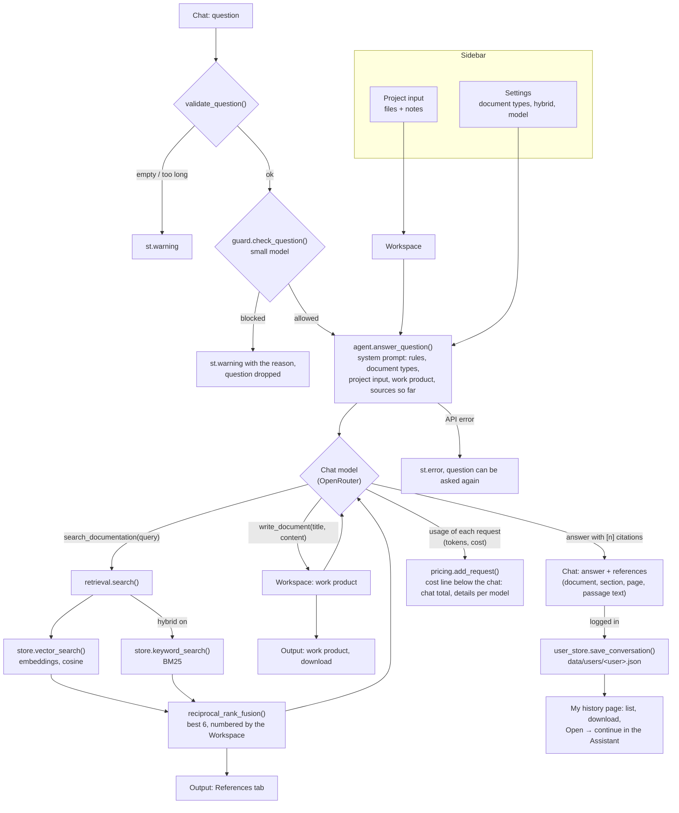

# Architecture

Building Rules Assistant: a chatbot that helps find the building regulations and standards that apply to a project, from documents in a knowledge base (task description: `125.md`).

## Components

All modules are in `src/scanya_ae_afa_updated0209_2_5/`.

| Component | Location | Purpose |
|---|---|---|
| App entry | `app.py` | Page setup, the custom CSS (box heights, denser sidebar, a light tint per area), navigation between the three pages, and the language flags and login box at the top of the sidebar. Run with `start_app.bat`. |
| Assistant page | `page_chat.py` | The main page, three areas: sidebar = the project (**Project input**, **Documents to search**); centre = the interaction (**Chat** with the **Export** and *New conversation* buttons; an empty chat shows a welcome line and example requests that are asked with one click; the user's questions sit on the right in a grey bubble with an architect avatar, the answers on the left with a scales avatar; then the question field, model / passages / searches and the cost line); right = the result (**Output**: work product, references or search steps in a box as high as the chat box; below it the buttons to switch views, with a green dot on views with new content, and the **flow diagram**). Only draws and stores the session state; no feature logic. |
| Languages | `translations.py`, `language.py` | The interface in English, Catalan and German. `translations.py`: every interface text as one entry with three versions, and `text(key, language)`; no Streamlit code. `language.py`: the flag buttons (`picker()`, flags drawn with CSS) and `t(key)`, which looks a text up in the language the user picked (`st.session_state["language"]`). |
| Export | `export.py` | `to_markdown()`, `to_csv()`, `to_json()`: the conversation on the page as a download (*Export* button above the chat). No Streamlit code. |
| Flow diagram | `flow_diagram.py` | You → Guard → Model ⇄ Knowledge base / Work product / Answer, as HTML. `next_stage()` turns the agent's events into the step that runs now; the page redraws the diagram after every event, the running step pulses. A step that just ended fades out in `AFTERGLOW_SECONDS` (1.5 s; CSS in the browser, so the answer is not delayed), so short tool steps stay visible next to the model; the page passes the seconds since each step ended, so a redraw continues a fade instead of restarting it. No Streamlit code. |
| Knowledge base page | `page_library.py` | Secondary page. Everyone: the list of documents. Admin only: upload documents into a category, remove them, rebuild the index, and the App settings form. |
| App settings | `app_settings.py` → `data/app_settings.json` | Settings the admin saves for everyone: defaults for new conversations, spending limit, guard on/off. `load()` falls back to `settings.py` and repairs invalid values; `save()` also copies the file to the history backup; `reset()` (button *Reset to code defaults*) saves the `settings.py` values again, rather than deleting the file, which would come back from the backup. No Streamlit code. |
| Password tool | `set_password.py` | `uv run python -m scanya_ae_afa_updated0209_2_5.set_password <user>`: sets an account's password in `config.yaml` (hidden input, bcrypt hash). |
| History page | `page_history.py` | "My history": the saved conversations of the logged-in user, each with its cost, a download of its work product and an *Open* button. |
| Guard | `guard.py` | `check_question()`: a small, cheap model (`settings.GUARD_MODEL`) judges each question with structured output before the chat agent runs: prompt injection, off-topic and harmful requests are blocked. No Streamlit code. |
| Chat agent | `agent.py` | `answer_question()`: a LangChain agent (`create_agent`) with three tools, `search_documentation`, `read_passages` and `write_document`. Yields its steps as `Event`s. No Streamlit code. |
| Workspace | `workspace.py` | `Workspace`: what one conversation works with besides the messages: project input (the user's files and notes), the work product, and the numbered sources. No Streamlit code. |
| Prompts | `prompts.py` | The system prompt, the guard's prompts and the fixed tool answers, as constants. |
| Search | `retrieval.py` | `search()`: vector search + keyword search merged with Reciprocal Rank Fusion; keyword part can be switched off. |
| Search index | `store.py` → `data/index/` | One LanceDB table with text, embedding and metadata of every chunk. The only module that talks to the database. |
| Document library | `library.py` → `data/library/<category id>/` | `add_document()`, `remove_document()`, `list_documents()`, `sync_index()` (embed new files, drop deleted ones), `rebuild_index()` (embed everything again). Keeps the original files, so the index can be rebuilt. |
| Build tool | `build_index.py`, `build_index.bat` | The same sync and rebuild from the command line, without the app. Shows what it will do and the estimated cost, and asks before embedding. |
| Chunking | `chunking.py` | `read_pages()` (PDF with `pypdf`, TXT, MD) and `split_pages()`: overlapping chunks that keep their page number and their section (the headings above them, e.g. "4 Bäder › 4.2 Lüftung"). |
| Embeddings | `embeddings.py` | `OpenRouterEmbeddings`: LangChain-compatible wrapper around `config.get_client()`. |
| Auth | `auth.py` | Optional login with `streamlit-authenticator`: `login_area()` draws log in / create account (or "signed in as" + logout), `current_user()` tells the pages who is logged in. Taken from the Sprint 1 project. |
| Accounts | `config.yaml` | User accounts (bcrypt-hashed passwords), name and lifetime of the login cookie. Committed on purpose with four demo accounts (sergi, lluis, turing, guest), so they are always available on the hosted app. The key that signs the cookie is the secret `AUTH_COOKIE_KEY` (environment / Secrets). |
| User store | `user_store.py` → `data/users/` | Per-user history: one JSON file per user with all conversations (messages, workspace, settings, usage). No Streamlit code. |
| History backup | `history_backup.py` → private GitHub repository | `download()` / `upload()` of a user's JSON file through the GitHub contents API, so the history survives restarts of the hosted app. On only if `HISTORY_REPO` and `GITHUB_TOKEN` are set. No Streamlit code. |
| Pricing | `pricing.py` | Cost of every chat-model request, added up per model: the cost OpenRouter reports, else tokens × the model's price from the OpenRouter models endpoint. `estimate_answer_cost()` gives the cost of one typical answer per model, shown next to each model in the Model select box. `format_usd()` for display. Taken from the Sprint 1 project. |
| Categories | `categories.py`, `categories.toml` | The document types (id, name, description, and optionally the name and description in Catalan and German). Edit the TOML file to change them. |
| Config | `config.py` | Taken from the Sprint 1 project: `get_client()` (OpenAI SDK client for OpenRouter, key from `.env` / the environment), plus `get_chat_model()` for LangChain. |
| Settings | `settings.py` | Constants: folders, model names, chunk and search parameters, limits. |
| Streamlit config | `.streamlit/config.toml`, `.streamlit/secrets.toml.example` | Accent colour and upload size limit; template of the Secrets of the hosted app. |
| Tests | `tests/test_backbone.py`, `tests/test_history_and_costs.py`, `tests/test_build_index.py`, `tests/test_guard.py`, `tests/test_admin.py`, `tests/test_flow_diagram.py`, `tests/test_translations.py` (languages and export); fakes in `tests/fakes.py` | Offline tests with fake models and a fixed price list (`uv run pytest`). |
| Documentation | `docs/` | Task description (`125.md`), this file, task tracker (`TASKS.md`: status of the core and optional tasks) and diagrams (`Schema.png`, `model_costs.png`). `README.md` and `CLAUDE.md` stay in the root, where GitHub, `pyproject.toml` and Claude Code look for them. |
| README | `README.md` | Features, setup, how to run. |

## How they work together

**Knowledge base** (prepared once, extended any time). On the Knowledge base page the user picks a category and uploads files. `library.add_document()` reads the text (`chunking.read_pages()`) and splits it (`split_pages()`): first at every recognised heading, then into chunks of about 1,000 characters, never across a page. Each chunk is embedded (`embeddings.py`) and stored as one row in LanceDB (`store.add_chunks()`): text, vector, category, file name, section, page. What is embedded and keyword-indexed is the passage together with its file name and section headings. The original file is kept in `data/library/<category id>/`.

**A conversation** happens on the Assistant page. The user can describe the project in the *Project input* section (files and notes, kept in the `Workspace`, not added to the knowledge base), choose in the sidebar which document types are searched and whether hybrid search is on, below the chat which model answers, how many passages the model gets per search and how many searches it may make per answer, and then chats. For each question `page_chat.py` calls `agent.answer_question()` with the question, the earlier messages, the workspace and the settings.

**The guard.** Before anything else, `answer_question()` calls `guard.check_question()`. The guard model sees its own fixed rules, the start of the assistant's last answer (so "and for hotels?" is understood as a follow-up) and the question, and answers `allowed` + a one-sentence `reason`. A blocked question yields a `blocked` event and ends there: the chosen chat model is never called. The page shows the reason, written by the guard in the interface language, as a warning and drops the question from the conversation, so it is neither sent as history nor saved. The guard's request is reported as a `usage` event and appears in the costs under its own model.

**One answer.** The agent's system prompt contains the rules of behaviour, the active and switched-off document types, the project input, the current work product and the list of passages found so far. The chat model then decides which tools to call:

- `search_documentation(query)` → `retrieval.search()` runs `store.vector_search()` and (if hybrid is on) `store.keyword_search()`, both restricted to the active categories, and merges the two rankings. Each passage gets a number from the workspace (`Workspace.add_source()`); the same passage keeps its number for the whole conversation. The model receives the numbered passages (as many as set in *Settings*, 6 by default) with document, section and page.
- `read_passages(numbers)` → the text of passages found earlier in the conversation, taken from the workspace (the system prompt lists only their locations). For follow-up questions: no new search, no embedding request.
- `write_document(title, content)` → replaces the work product in the workspace.

After reading the passages the model may search again, with other words or for an article the passages refer to, up to the number of searches set in *Settings* (4 by default, at most 8). After that the search tool refuses and tells the model to answer with what it has, so the answer still comes; `MAX_AGENT_STEPS` (30) is only a safety net against a looping model and stops the run with an error. It then answers, citing passage numbers like `[1]`. The page shows every step while it happens (status box), the answer, and below it the cited references: document, section, page, and the exact passage text. The *Output* section shows the work product (with its own references and a download button) a *References* tab listing every passage found in the conversation, and a *Search steps* tab: for each answer the path the agent took (Question → Search 1 → Search 2 → Answer), the settings it was made with, and for every search all passages the model was given, best first, with two match values as bars and a mark on the ones the answer cites.

**Costs.** Each answer needs several requests to the chat model (one per tool round, plus the final one). `answer_question()` reports each of them as a `usage` event with the model and the token counts LangChain returns. The page adds them to the conversation's usage (`pricing.add_request()`), also when the run fails afterwards, since those requests are billed too. The *Costs* section shows the total of the chat, one line per model used, and for a logged-in user the total over all saved conversations (`user_store.total_cost()`).

**Logged-in users** (optional, `auth.py`). The app works without an account. `app.py` draws the login box in the sidebar on every page; a login is remembered by a cookie for 30 days. After every answer, the page saves the whole conversation to the user's file (`page_chat._save_conversation()` → `user_store.save_conversation()`): messages with steps and sources, the workspace (project input, work product, numbered sources), the settings and the usage. *My history* lists the conversations, last changed first; *Open* loads one back into the session (`page_chat.open_conversation()`) and switches to the Assistant page, where it continues under the same id. A conversation started without login is kept at login and saved to that user; at logout the page is cleared.

**Languages.** Every text of the interface is looked up with `language.t(key)` in the language picked with the flags (English, Catalan, German); switching redraws the page and keeps the conversation, settings and login. The chat model is not affected: it answers in the language of the question, whatever the interface language, and searches in the language of the documents (Spanish, Catalan). The guard is told the interface language for its reason.

**Export.** The *Export* button above the chat offers the conversation on the page as Markdown (to read; answers with their references, then the work product), CSV (one row per message, for Excel) and JSON (everything, in the format of the saved history). It is drawn after the answer of the current run, so the download always includes the last answer.

**Where does it come from?** Because passage numbers are fixed and the system prompt lists them with document, section and page, the user can ask at any time where a statement comes from; the model names document, section and page, and can re-read the passage (`read_passages`) for the exact wording.

## Modules and functions

Imports go one way, in layers:

- **Pages:** `app.py` → `language.py`, `auth.py`, `page_chat.py`, `page_library.py`, `page_history.py` → `agent.py`, `workspace.py`, `export.py`, `library.py`, `user_store.py`, `pricing.py`, `categories.py`, `settings.py`. All of them look texts up through `language.py` → `translations.py`. `page_history.py` also uses `page_chat.open_conversation()`.
- **Logic:** `agent.py` → `guard.py`, `retrieval.py`, `workspace.py`, `prompts.py`, `config.py`; `library.py` → `chunking.py`, `embeddings.py`, `store.py`; `retrieval.py` → `store.py`, `embeddings.py`; `workspace.py` → `chunking.py`.
- **Services:** `embeddings.py` → `config.py`; `store.py` → LanceDB; `user_store.py` → `pricing.py` (totals), JSON files; `pricing.py` → OpenRouter models endpoint. `settings.py`, `prompts.py` and `translations.py` are constants only (`translations.text()` aside). `flow_diagram.py`, `workspace.py` and `export.py` use `translations.py` for the labels they write.

| Module | Function / class | What it does |
|---|---|---|
| `agent.py` | `answer_question(question, history, workspace, active_category_ids, model_name, hybrid, top_k, max_searches, use_guard, language)` | Runs the guard; if allowed, builds the three tools and the system prompt for this answer, runs the agent loop and yields `Event`s (`tool_call`, `tool_result`, `usage`, `answer`, or `blocked`). Changes the workspace (sources, work product). |
| `guard.py` | `check_question(question, history, language="English")` → `GuardResult` | `allowed`, the reason for the user if not (in `language`; empty if the reply had no readable verdict), and the usage of the guard's request. Model errors are raised (fail closed); a reply without a readable verdict counts as blocked. |
| | `validate_question(question)` | Empty or too long (`MAX_QUESTION_LENGTH`): returns the key of the message in `translations.py`, else `None`. |
| `workspace.py` | `Workspace.add_project_file()`, `project_input()`, `project_input_is_cut()` | Read a project file; build the text sent to the model (cut at `MAX_PROJECT_INPUT_CHARS`). |
| | `Workspace.add_source(hit)`, `sources_by_number()` | Give a passage its fixed number; list sources. |
| | `Workspace.export_document(language)`, `reference_list()`, `citation_numbers(text)` | Work product as Markdown with a reference list; numbers cited in a text. |
| `export.py` | `to_markdown(conversation, language)`, `to_csv(conversation)`, `to_json(conversation)` | The conversation (the dict saved in the history) as a download. CSV with a BOM, so Excel reads the accents. |
| `translations.py` | `text(key, language, **values)` | The text in that language with its placeholders filled in; unknown language → English. |
| `language.py` | `t(key, **values)`, `current()`, `picker()` | The same in the user's language; the flag buttons. |
| `retrieval.py` | `search(query, categories, hybrid, k)` → `Hit` | 20 candidates per search, best `k` after merging (6 by default). A `Hit` has text, file, page, category, the merged score, and for each search its rank and raw match value (`similarity`, `keyword_score`). |
| | `reciprocal_rank_fusion(rankings)` | `score = Σ 1 / (60 + rank)` over the rankings containing the chunk. |
| `store.py` | `add_chunks()`, `vector_search()`, `keyword_search()`, `list_documents()`, `delete_document()`, `reset()` | Table is created on first use, with a BM25 keyword index on `search_text` (file name + section + passage). Both searches filter on the category before ranking. `list_documents()` also counts the sections found per document. |
| `library.py` | `add_document(file_name, data, category_id)` | Validates (category, size, type, file name), then the ingestion flow above. Same name in the same category replaces the old version. |
| `chunking.py` | `read_pages()`, `split_pages()` → `Chunk` | `read_pages()` raises `ValueError` for unsupported, broken or text-less (scanned) files. `split_pages()` follows the headings with `_SectionTracker` and gives every `Chunk` its `page` and `section`. |
| `embeddings.py` | `OpenRouterEmbeddings`, `get_embeddings()` | `client.embeddings.create()` in batches of 100 texts. |
| `config.py` | `get_client(provider)`, `get_chat_model(model_name, temperature)` | `load_dotenv()`, then the key from the environment (`KeyError` if missing). The agent passes `settings.TEMPERATURE`. |
| `categories.py` | `Category`, `load_categories()` | Reads and validates `categories.toml`. |
| `auth.py` | `login_area()`, `current_user()`, `is_admin()` | `_get_authenticator()` creates `config.yaml` if missing (no users, random cookie key) and builds the `streamlit_authenticator.Authenticate` from it, with `_AnyPassword` as validator. |
| `user_store.py` | `load_conversations(username)`, `save_conversation(username, conversation)`, `total_cost(username)` | Read the user's file (first downloaded from the backup if it is not on the disk); insert or replace a conversation by its `id` (sets `created` / `updated`) and upload the file to the backup (`BackupError` if that fails; the local copy is saved anyway); sum of the cost of all saved conversations. |
| `history_backup.py` | `is_enabled()`, `download(path)`, `upload(path, data, message)` | GitHub contents API: read a file (None if missing), create or replace it with one commit. |
| `store.py` | `compact()` | Merge the table's files and delete old versions; run by the build tool only. |
| `pricing.py` | `add_request(usage, model, input_tokens, output_tokens, reported_cost)` | Adds one request to the usage dict: `{model: {requests, input_tokens, output_tokens, cost, unpriced}}`. |
| | `request_cost()`, `total_cost(usage)`, `total_tokens(usage)`, `format_usd()` | Cost of one request (`None` if no price is known: counted as `unpriced`); totals over all models; display format. |
| `page_chat.py` | `open_conversation(conversation)` | Loads a saved conversation into the session state (used by `page_history.py`). |

Session state of the Assistant page (`st.session_state`): `messages` (answers with their `steps`, `sources` and the `settings` they were made with), `workspace`, `active_categories`, `hybrid`, `top_k`, `max_searches`, `model_name`, `usage`, `conversation_id`, `unsaved`, `owner` (who was logged in at the last draw), `language` (set by the flag buttons), `pending_question` / `answering` (a question sent and the run that answers it), `chat_notice` (a warning or error shown in the chat after that run), and two counters (`conversation`, `upload_round`) used in widget keys. The login state (`authentication_status`, `username`) is kept there by `streamlit-authenticator`.

## Decisions

- **uv** with **Python 3.14** and a committed `uv.lock`. Not 3.15 as in the Sprint 1 project: LangChain depends on `langsmith` → `zstandard`, which has no ready-made build for Python 3.15 yet (installing would need a C compiler). Nothing needs 3.15. The `aie-labs` repo is on 3.14 for the same reason.
- **`config.py` reused from the Sprint 1 project**, so the API key is found the same way: environment variable first, `.env` as an alternative. The embeddings call goes through `get_client()` like in the labs; only the chat model needs a LangChain object (`get_chat_model()`).
- **Streamlit** for the UI, as allowed by the task. Pages and logic are separated, as in Sprint 1, so the logic is testable without the UI and another frontend could reuse it.
- **The chat is the centre of the page.** Chat and output sit side by side and fill the window height; the sidebar holds what belongs to the project (login, project input, documents to search), the centre column the interaction (chat, question field, the settings a user changes from chat to chat, costs), the right column the result (output, view buttons, flow diagram); the knowledge base is a second page. One CSS block in `app.py` sets the box heights (Streamlit has no "fill the window" option); chat box and output box have the same height, so their tops and bottoms line up, with room below for the question field, chat settings and cost line (left) and the view buttons and flow diagram (right); the page links at the top start where the content starts; the same block makes the sidebar denser (lower header, smaller gaps), so it fits on one screen. The project input is collapsed (its title says what it holds; its explanation is the "?" of its file field). Below the question field: sliders with their range in the label (the min/max row is hidden), and one cost line ("This chat: $… · tokens · Spent: $… / max $…"; spent counts all of the user's conversations, as the limit does). The main area has 2rem side padding instead of Streamlit's 5rem, and below 1250px window width the view buttons lose their icons and the diagram its subtitles, so the columns still fit in smaller windows. While an answer runs, the flow diagram shows which step is running (the agent's events are reported when a step ends, so `flow_diagram.next_stage()` infers the next one) and the status box in the chat names it; The output views are switched with a segmented control below the box, not with `st.tabs`: tabs always put their buttons on top, and forget the chosen tab when a label changes (the label carries the count and the green dot). A view gets a dot when its content changed since it was last shown (`page_chat._output_versions()`, `"output_seen"` in the session).
- **Controls are locked while an answer runs.** Any click in Streamlit restarts the script from the top, which stops a running answer halfway: its model requests are paid, but the answer is lost. So a question (question field or example button) is only stored by a callback (`pending_question`); the next run draws every control disabled (flags, document switches, project input, model and sliders, New conversation, Export, output views), answers, and then redraws the page once (`st.rerun()`) with the controls enabled; warnings and errors about the question are kept for that redraw (`_notice()`). The page links and a reload cannot be disabled: a question left without answer is removed at the next draw of the page, with a note to ask again.
- **A colour code links the controls to the steps they change.** The flow diagram is the key (`flow_diagram.COLOURS`): green = knowledge base (the *Documents to search* box with hybrid search, the References view), blue = model (the model, passages and searches row below the question field, the Search steps view), orange = work product (its view); You, Guard and Answer, and so the chat and the project input, stay neutral grey. The output view buttons and boxes take the colour of their view, and the Search steps path uses the same colours. Only the *Documents to search* box is green, not the whole sidebar: the project input goes into the prompt, not into the knowledge base (it belongs to "You"). All tints are see-through, so dark mode still works. The colours are set by CSS in `app.py` (Streamlit has no colour option for containers or segmented-control buttons), on the containers' keys. **Document types get their own greens** (`flow_diagram.CATEGORY_SHADES`, dark to light in the order of `categories.toml`): their name and switch in the sidebar, the bar on the left of their references and their box on the Knowledge base page. Everything about the knowledge base as a whole keeps the one teal green (the app's primary colour, also the "cited" marks, the meaning bars and the new-content dots): the type greens stay inside the knowledge-base colour family, so they add detail without breaking the code. With more types than shades, the shades repeat.
- **Hybrid search = two searches + RRF**, with a switch. Embeddings find meaning but blur exact identifiers ("Art. 6", "DIN 4102-4", "2,50 m"); BM25 finds exact words but not meaning. Ranks are merged instead of scores because the two scores are on different scales. Switched off, only the vector search runs.
- **LanceDB** as vector database: one local folder, no server, and the same table does vector search, BM25 keyword search, category filters and deleting a document. Considered: Milvus Lite (Lab 2; same features, better if the data should later move to a Milvus server), Chroma (larger install, keyword search not evaluated), FAISS (no metadata filter).
- **Categories filter before ranking**, so a switched-off document type cannot push active results out of the candidates. Categories live in `categories.toml`: today `cte` (national rules, CTE), `gencat` (Catalonia) and `poum_terrassa` (Terrassa's municipal plan), one per folder of `data/library/`. The invented documents of `sample_data/` use six other categories, kept in `tests/categories.toml`: the tests read that file (`tests/conftest.py`), so they do not depend on the real categories.
- **Search is a tool of an agent, not a fixed step.** The model writes the search query itself (follow-up questions become complete queries) and can search several times. Tools are built per answer and bound to the active categories, so the model cannot search a switched-off type.
- **Passage numbers are fixed for the whole conversation** (kept in the `Workspace`). This is what makes references reliable: `[3]` means the same passage in every answer, in the work product and in the References tab.
- **References show the retrieved text itself**, with document, section and page, not a summary by the model. Chunks never span pages or sections, so both are exact. Cost: a rule continuing on the next page is split in two chunks.
- **Sections are recognised by cautious rules, not by a model** (`chunking._SectionTracker`): Markdown headings, legal structure ("Erster Teil", "Abschnitt 2", "§ 14", "Art. 6", also with the title on the next line), and numbered headings ("4 Bäder", "4.2 Lüftung"). A line only counts if it is short and does not read like a sentence; "§ 14 Abs. 2 gilt …" or "3 Stellplätze je Wohnung …" stay text. A wrong section in a reference is worse than none, so a document without recognisable headings simply gets page-only references. The Knowledge base page shows the number of sections found per document, to check this. Not yet tried on real regulation files.
- **File name and section headings are searched with the passage** (`search_text`), so "ventilation in bathrooms" also finds a passage that only states a value below the heading "Bäder › Lüftung". The passage shown to the user stays the original text.
- **Project input goes into the prompt, not into the knowledge base.** It describes the project and is usually short; the model should always see it. It is capped at 30,000 characters because it is sent with every question. Rules must come from the knowledge base only.
- **The work product is written by a tool** (`write_document`), always as the complete document, and shown next to the chat. The current version is part of the system prompt, so "add a section on escape routes" works as an iteration.
- **Parameters live in `settings.py`; only four are settings of a conversation.** Document types, hybrid search, passages per search and searches per answer can be changed in the app, because they act at once and cannot damage anything. Chunk size, overlap and embedding model stay in code: they decide what is stored in the index, so a change needs "Rebuild index". Temperature is fixed at 0, so that an assistant quoting rules and values gives the same answer to the same question.
- **Match values are shown as they are, not as a confidence.** Per passage and search: `similarity` (1 − cosine distance, fixed scale 0 to 1) and `keyword_score` (BM25, no fixed scale, so its bar is relative to the best match of that search). Neither says how likely the passage answers the question; a real relevance score would need a reranking model, which the app does not have. The order of the passages is the merged ranking (RRF).
- **The model is told that it does not see its earlier searches** (`prompts.SYSTEM_PROMPT`): with only questions and answers as history, it otherwise "corrected" itself and claimed that earlier searches had not been run.
- **Only questions and answers are sent as history** (last 12 messages), not earlier passages: fewer tokens. The system prompt lists the locations of all passages found so far, and the model fetches the texts it needs with `read_passages`. Considered: also putting the full text of the last answer's passages into the system prompt; not done, because it overlaps with `read_passages` and would cost those tokens on every question, also when they are not needed.
- **Passages per search and searches per answer are two different levers.** More passages per search widen one ranking (helps when the right passage was ranked just below the cut); more searches let the model ask again after reading (other words, an article a passage refers to). The search limit is enforced by the tool, not by the agent's step limit, so reaching it still gives an answer.
- **Original files are the source of truth, the index is derived.** Nothing is embedded by itself: files copied into or deleted from `data/library/` take effect when `build_index.bat` runs (sync by category + file name; a file replaced under the same name is not noticed). A full rebuild, needed after changing chunk size, heading rules or embedding model, asks for confirmation in the app and in the tool, because it costs money. `data/library/` and `data/index/` are committed (see "The base library" below); copyrighted documents (e.g. DIN standards) must not be added there.
- **Optional login with `streamlit-authenticator`, reused from the Sprint 1 project**: passwords are stored as bcrypt hashes in `config.yaml`, which is committed with the demo accounts (`sergi`, `lluis`, `turing`, `guest`). A real deployment would git-ignore it. Permanent accounts are added by the admin locally (`set_password.py`, commit, push). Accounts can also be created in the app, but on the hosted app `config.yaml` comes back from git at every restart, so they only last until then; the *Create account* tab says so and points to the admin.
- **The knowledge base is changed in code, not in the GUI.** The permanent library is `data/library/` + `data/index/` in git, changed locally with `build_index.bat`. The admin's upload, remove and rebuild buttons on the Knowledge base page stay, to show the feature, but on the hosted app their changes last only until the next restart (the page says so). Not backed up on purpose: the index would have to be copied after every change, for a feature that is only shown. The box sits in the sidebar so it is on every page and the chat keeps the main area.
- **No password rules for now**: the library demands 8-20 characters with upper case, lower case, digit and special character, with no switch to turn that off. `auth._AnyPassword` replaces only that check through the library's `validator` argument; delete it to get the rules back.
- **Login details learned the hard way**: the login cookie is written by a browser component, so the page waits one second before redrawing after a login or logout (`COOKIE_WAIT_SECONDS`); redrawn at once, the cookie was never written and a reload logged the user out. And the login box is drawn after `st.navigation()`, otherwise reading the cookie sends a page opened by its address back to the Assistant page.
- **History = one JSON file per user, the whole conversation saved after every answer**: as in the Sprint 1 project, readable and without a database. Saving everything (messages, workspace, settings, usage) is what allows continuing a conversation with the same passage numbers and work product. Changes made between two answers (notes, settings) are saved with the next answer. The files are in `data/users/`, git-ignored unlike in Sprint 1: conversations contain passages of the knowledge-base documents.
- **Costs: real cost if reported, estimate otherwise, per model**: OpenRouter returns the cost of a request and `langchain-openrouter` passes it on; if it is missing, tokens × the per-token prices of that model from `https://openrouter.ai/api/v1/models` (fetched once per app run). Costs are stored per model because the model can be changed during a conversation. The user's total is the sum over the saved conversations, so there is no second number to keep in step. Embedding requests are counted too: `OpenRouterEmbeddings` notes each request in its `usage` list, the agent reports the query of every search as a `usage` event (its own line in the chat costs), and the Knowledge base page and the build tool show the cost of embedding documents. The embedding model is not in the chat price list, so its price is a constant in `settings.py`.
- **Prompt-injection guard = a small model in front of the big one** (`guard.py`). Every question is judged first by the cheapest model of the list (`openai/gpt-6-luna`, about 520 input / 25-45 output tokens, ≈ $0.0001 per question), whichever chat model the user chose; only allowed questions reach the chat model and the knowledge base. It blocks prompt injection, off-topic requests and requests for harmful help, and is told to allow when unsure about the domain, since the assistant answers only from its documents anyway. It **fails closed**: if the guard cannot be reached the question is not answered (a guard that lets everything through when it fails protects nothing; besides, the chat model would usually fail as well). Its reason is in the interface language, named explicitly in its prompt ("Language of the reason: Catalan"): asked for "the language of the message" instead, the model answered English messages in Spanish or French. Only the question is checked, not the project input or the documents: they are long and sent with every question, so the prompt rule below covers them. Considered: `openai/gpt-oss-safeguard-20b` (a model made for such policies, slightly cheaper); not usable: the course API key's OpenRouter guardrail blocks it (checked 2026-11-26), and it has only two providers (one degraded at the time) against six for gpt-6-luna.
- **Hosting on Streamlit Community Cloud** (free, the app runs on Streamlit's servers). Three consequences shaped the code: (1) the key comes from the app's Secrets, which Streamlit passes on as environment variables, so `config.py` stays unchanged and free of Streamlit code; (2) Streamlit puts only the folder of `app.py` on the import path and does not promise to install the package, so `app.py` adds `src/` itself; (3) the server's disk is temporary, so whatever must survive is in git: the base library and its index in the app's repository, the histories in a separate private repository.
- **The base library and its index are committed** (`data/library/`, `data/index/`; before: git-ignored), so the hosted app answers from the first minute without embedding anything. Today they hold the real documents (CTE, GENCAT, POUM Terrassa; 16 PDFs), which are public regulations; copyrighted documents (e.g. DIN standards) must stay out. The build tool compacts the index after every run (13 documents: 315 files / 7.5 MB before, 11 files / under 1 MB after), so a commit does not carry LanceDB's old versions.
- **History backup in a separate private repository, through the GitHub API** (`history_backup.py`): a commit to the app's own repository would restart the app for everyone, and a separate repository lets the token reach the histories only. The whole user file is uploaded after every answer (one commit each: simple, and fine for a few testers). A missing local file is downloaded first; a failed download is an error, not an empty history, so a save can never overwrite the backup with less. Accounts created on the hosted app (`config.yaml`) are not backed up yet.
- **Spending limit per user** (default `settings.SPENDING_LIMIT_USD`, $1; the admin can change it): checked before each answer against what the user spent: the history total when logged in (it survives restarts through the backup), otherwise the conversations of the browser session (`session_cost`). An answer that is already running is finished, so the limit can be passed by the cost of one answer. The credit limit on the key at OpenRouter is the hard ceiling.
- **The login-cookie key is a secret, not part of `config.yaml`** (`auth._cookie_key()`): whoever knows it can make a valid cookie for any user name and read that user's history. It comes from `AUTH_COOKIE_KEY` (`.env`, the app's Secrets); without it a random key is made per server process, so nothing breaks but logins are not remembered across restarts. The old key is in the git history and must not be reused. Because streamlit-authenticator reads the key from the file whenever it gets the file path, it now gets the accounts as a dict, and `auth.login_area()` writes the file itself after a new account (`_save_config()`).
- **One admin, set in `config.yaml`, not in the app** (`roles: [admin]` for `sergi`; `auth.is_admin()` reads the file on every page run). The admin alone changes what all users share: the knowledge base (upload too, not only remove: an upload replaces a document with the same name, its text reaches every user's answers unchecked by the guard, and its embedding cost is not counted against any spending limit) and the app settings. Other users and visitors see the document list and change the search settings for their own conversation only. Since the demo passwords are in the README, the admin's password is set apart with `set_password.py`.
- **App settings in a file next to the histories** (`data/app_settings.json`, git-ignored, backed up to the history repository): saved from the app, so the hosted app keeps them across restarts without a push (which would restart it). Saved values are checked on reading, so a stale file (removed model or document type) falls back to `settings.py`.
- **Interface in three languages, chosen with flags** (`translations.py`, `language.py`). All texts are in one Python dict, key → (English, Catalan, German), rather than in gettext `.po` files: no tool chain, and a test checks that every text exists in every language with the same placeholders and that every key used in the code exists. The flags are drawn with CSS on a segmented control: Windows shows flag emojis as letters and Catalonia has no flag emoji. The language is kept for the browser session only. The documents are not translated: the embedding model is multilingual (measured: the best passage is the same for a question in English, Catalan or Spanish, with lower similarity values in Catalan), and the chat model answers in the language of the question. Not translated: rare technical error messages from libraries and logic modules, and the tool messages, which are read by the model.
- **Export in three formats, built from the saved-history dict** (`export.py`): Markdown for people, CSV for spreadsheets, JSON for everything (including search steps and costs). No PDF: it would need an extra library and a bundled font for the accents; Markdown can be printed to PDF from any editor.
- **Security so far**: admin role (above); guard (above); length limit for questions; upload limits (type, size, sanitised file name); category and document ids validated before use in filters; the system prompt treats search results, project input and work product as material, never as instructions, answers only from the documents and adds a "not legal advice" note.

## Diagram: from question to answer

